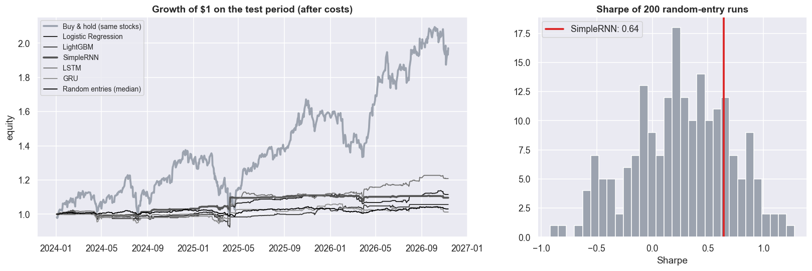
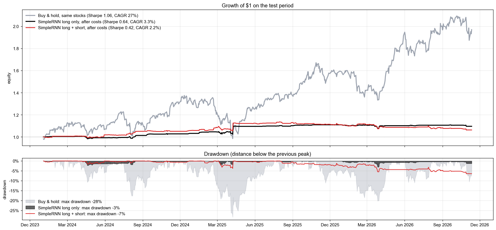
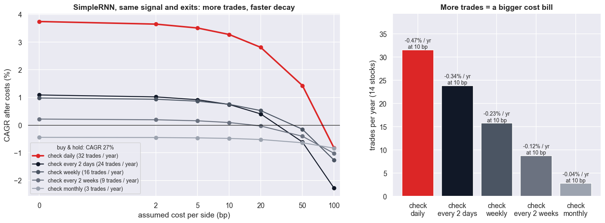
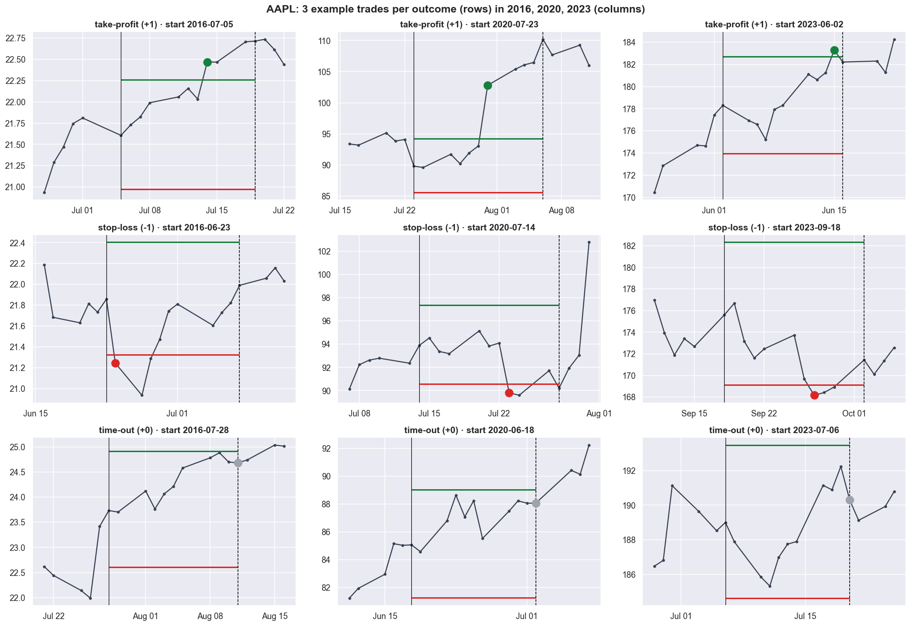
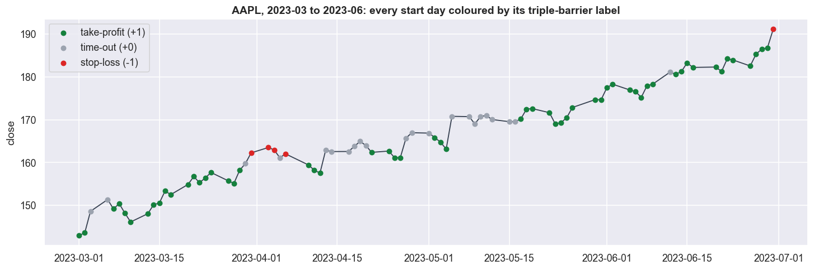

# Stock Triple-Barrier Classification (RNN / LSTM / GRU)

Many stock notebooks predict the scaled closing price with RNN, LSTM and GRU models and report R² ≈ 0.99, but copying
yesterday's price scores R² 0.995–0.9996 on price levels too. This project asks a question a trader actually faces: **if I buy today, will the trade hit its take-profit, its stop-loss, or run out of time?**

| Result on unseen data (2024-01 to 2026-10) | Value |
|---|---|
| Best log-loss (SimpleRNN) vs no-information baseline | 1.060 vs 1.099 |
| Balanced accuracy (3 classes, chance = 0.333) | 0.40-0.41 for all models |
| Long-only rule vs buy-and-hold of the same stocks (Sharpe) | 0.10-0.78 vs 1.06 |
| Best model's Sharpe vs 200 random-entry runs | beats 79 % (not significant) |

**Conclusion:** the outcome is predictable slightly better than chance, mostly *whether* a stock will move enough to hit a
barrier rather than *which way*. That edge does not turn into a trading rule that beats buy-and-hold.

## Objective


Phases 1-2 are built here; the faded Phases 3-7 (signal threshold, regime filter, risk manager, executor, monitor) are a guideline for turning the model's probabilities into a full trading loop.

- **Problem** → most "stock prediction" notebooks predict tomorrow's price and report R² ≈ 0.99, yet copying yesterday's price scores the same: it looks smart and tells a trader nothing
- **Why this repo** → ask the question a trader actually has, *"if I buy today, do I hit my take-profit, my stop-loss, or run out of time?"*, and test it without leaking the future
- **Real-world use** → a sanity check before trusting any trading signal: label trades by outcome, purge overlapping samples, and compare against buy-and-hold and random entries

## Highlights

**Question:** can a model tell whether a trade will hit take-profit, stop-loss or time out?

**Answer:** a little. The best log-loss is 1.060 against 1.099 for knowing nothing, and all five models (logistic regression, LightGBM, SimpleRNN, LSTM, GRU) are within 0.012. The models mostly learn *whether* a stock will move (volatility), not *which way*.

In probability terms, $e^{-\text{log-loss}}$ is the typical probability given to what really happened: 0.346 for SimpleRNN against 0.333 for the prior.


**Question:** does that edge make money after costs?

> **What is a bp?** A basis point (bp) is one hundredth of a percent: **1 bp = 0.01 % = 1 / 10,000**. Trading costs are quoted in bp because they are tiny per trade but add up.
>
> | Example | Calculation | Result |
> |---|---|---|
> | 10 bp on a $10,000 trade | $10,000 × 0.0010 | $10 |
> | 10 bp on a $714 position (this README's example) | $714 × 0.0010 | $0.71 per side, $1.43 to buy and sell |
> | 10 bp on one $200 share | $200 × 0.0010 | $0.20 |
> | A spread: bid $199.98, ask $200.02 | ($200.02 − $199.98) / $200 | $0.04 = 2 bp; buying at the ask and selling at the bid costs about 1 bp each way |
> | 100 bp | 100 × 0.01 % | 1 % |

**Answer:** no. Model-picked trades hit take-profit 44-51 % of the time (34 % for all trades), but after 10 bp costs no rule beats buy-and-hold, and the best one beats only 79 % of random-entry runs.

| Test 2024-01 to 2026-10 | Sharpe |
|---|---|
| Buy-and-hold, same stocks | 1.06 |
| Long-only model rules | 0.10-0.78 |
| Best model vs 200 random-entry runs | beats 79 % (not significant) |



**Question:** can the model also earn when it expects a fall (long and short)?

**Answer:** no. The rule buys when P(take-profit) ≥ 0.58, and otherwise sells short when P(stop-loss) ≥ 0.42 (both thresholds fixed on validation). A short earns when the price falls, so its take-profit is the lower barrier and its stop-loss the upper one.

| SimpleRNN rule, after 10 bp costs | Validation 2022-2023 Sharpe | Test 2024-2026 Sharpe |
|---|---|---|
| Long only | 0.89 | 0.64 |
| Long + short | 1.41 | 0.42 |

Shorting looked great on validation because 2022 fell. On the rising test period, the 86 short trades hit their take-profit only 33 % of the time and lost 0.8 % each on average (about $6 on a $714 position, see the dollar note below). Only one of five models (LSTM, 0.78 → 0.83) gains from shorts on test.

**Question:** where did the model trade, and where did each trade end?

**Answer:** the two stocks with the most short trades. IBM rose most of the period, and 16 of its 27 shorts were stopped out. GOOGL mixes 15 longs and 8 shorts. Black ▲ = buy, white ▼ = sell short, green / grey / red dot = the trade's own take-profit / time-out / stop-loss, shaded band = holding period.


**In dollars** → all USD figures below use an example account of **$10,000**, split equally across the 14 stocks, so one position is about **$714**. The percentages are what the backtest measures; the dollars are just those percentages applied to this account.

All 14 stocks, test period (return of one $714 position after 10 bp per side; holding time in trading days):

| Trades | Long | Short | All |
|---|---|---|---|
| Number of trades | 89 | 86 | 175 |
| Take-profit / time-out / stop-loss | 52 % / 18 % / 30 % | 33 % / 26 % / 42 % | 42 % / 22 % / 36 % |
| Win rate (return > 0) | 63 % | 47 % | 55 % |
| Average return per trade | +1.5 % (+$11) | -0.6 % (-$4) | +0.5 % (+$4) |
| Average / median holding | 5.4 / 4 days | 5.9 / 6 days | 5.6 / 5 days |
| Best / worst trade | +18.5 % (+$132) / -12.6 % (-$90) | +24.6 % (+$176) / -20.4 % (-$145) | +24.6 % (+$176) / -20.4 % (-$145) |

Longs win more often than they lose; shorts lose more often than they win, and they hold a little longer because a short's take-profit (a fall) is rarer in a rising market.

**Question:** how does $1 grow, compared with simply holding the same stocks?

**Answer:** over the 2.85-year test period, after 10 bp costs per side:

| Strategy | $1 becomes | $10,000 becomes | CAGR | Max drawdown |
|---|---|---|---|---|
| Buy-and-hold, same 14 stocks | $1.97 | $19,705 (+$9,705) | 26.9 % | -28 % from its peak |
| SimpleRNN long only | $1.10 | $10,962 (+$962) | 3.3 % | -3 % |
| SimpleRNN long + short | $1.06 | $10,631 (+$631) | 2.2 % | -7 % |



**Question:** does trading more often let the spread and slippage eat the edge?

**Answer:** yes, the cost bill grows with every trade, but here the edge per trade matters more. I only have daily closes, so the real spread and slippage are **assumed** (0 to 100 bp per side). Everything else is fixed: the same SimpleRNN, the same 21 features, τ = 0.58, the same triple-barrier exits, long only. Only how often the rule may open a trade changes.

In dollars, on the $10,000 example account ($714 per position), 10 bp per side = **$0.71 to buy + $0.71 to sell = $1.43 per trade**.

| Check for a signal | Trades / year | Avg gross gain / trade | Cost bill / year at 10 bp | Profit / year at 0 / 10 / 20 bp | Break-even cost per side |
|---|---|---|---|---|---|
| daily (the backtest above) | 32 | +1.7 % (+$12.00) | $47 | $374 / $328 / $281 | 82 bp ($5.84) |
| every 2 days | 24 | +0.6 % (+$4.57) | $34 | $109 / $75 / $41 | 32 bp ($2.28) |
| weekly | 16 | +0.9 % (+$6.29) | $23 | $98 / $75 / $53 | 43 bp ($3.09) |
| every 2 weeks | 9 | +0.4 % (+$2.64) | $12 | $22 / $9 / -$3 | 18 bp ($1.25) |
| monthly | 3 | -2.2 % (-$15.71) | $4 | -$44 / -$48 / -$52 | 0 bp ($0) |

Profit per year = CAGR × $10,000. Buy-and-hold made about $2,690 a year on the same account (CAGR 26.9 %).

- **The bill follows the count** → at 10 bp, $47 a year for 32 trades vs $4 for 3: about $1.43 per trade, i.e. 0.014 % of the account a year per trade ($2c$ per round trip × 1/14 of the capital)
- **Break-even ≈ half the average gross gain per trade** → a trade that earns $12.00 survives costs up to about $5.84 per side (82 bp); one that earns $2.64 dies at about $1.25 (18 bp)
- **Trading less didn't help** → checking less often skips many of the model's best days, so the trades got worse faster than the costs shrank

In short → the more often a strategy trades, the bigger the edge each trade needs. An intraday idea that earns 0.1 % per trade ($0.71 on $714) is gone at 5 bp per side ($0.36 + $0.36).



## Backtesting is just another lie

**Why not trust a nice equity curve?**

A backtest replays one past I already know, with rules I chose. The curve above already hides several choices:

- **One path** → 2024-2026 happened once. A different period (2022, 2008) could flip every number.
- **Picked stocks** → 14 tech names chosen in hindsight, most of which went up (selection bias).
- **Picked model and threshold** → five models were tried; showing the best one with τ = 0.58 is already a choice, even if τ came from validation.
- **The period teaches the rule** → shorting raised the validation Sharpe from 0.89 to 1.41 because 2022 fell, then cut the test Sharpe from 0.64 to 0.42 because 2024-2026 rose.
- **Few lucky days** → about half of the long-only gain comes from April 2025, and its five best days add up to more than the whole gain.
- **Easy execution** → fills at the close, an assumed 10 bp per side, no gaps, no missed orders. The real spread and slippage are unknown; a rule that trades often and earns little per trade can flip from profit to loss on that guess alone.
- **Low drawdown ≠ low risk** → the -3 % drawdown looks safe because the rule sits in cash most of the time (a position is open on only 39 % of days), not because it predicts crashes.

In short → a backtest can only prove a strategy is bad, never that it is good. This one does not even beat holding the stocks.

**Question:** why do so many notebooks report great results?

**Answer:** shuffled cross-validation. Neighbouring trades share most of their future days, so a shuffled split tests on near-copies: macro-F1 0.472 shuffled vs 0.394 purged with an embargo.

## Data

Daily prices from Yahoo Finance via `yfinance`, 2010-01-01 to 2026-11-11, split and dividend adjusted:
NVDA, CRWD, AMD, ADBE, MSFT, GOOGL, INTC, AAPL, AMZN, CRM, IBM, TSLA, PYPL, XYZ (Block, formerly SQ), plus SPY as market context.
The data is not committed; notebook 01 downloads it into `data/raw/`.

## Method

**Triple-barrier labels** (López de Prado, *Advances in Financial Machine Learning*). For each stock and day $t_0$:

| Barrier | Level | Label |
|---|---|---|
| take-profit | $P_0 \cdot e^{+0.75\,\sigma\sqrt{10}}$ | +1 |
| stop-loss | $P_0 \cdot e^{-0.75\,\sigma\sqrt{10}}$ | -1 |
| time limit | 10 trading days | 0 |

$\sigma$ is the stock's recent daily volatility (past returns only), so barriers adapt to calm and turbulent periods; $\sqrt{10}$ turns a daily move into a 10-day move, $m = 0.75$ sets the class mix, and the first barrier the close touches wins, so the label follows the path. This gives 36 % take-profit,
35 % time-out and 29 % stop-loss. Labels were verified against a brute-force recomputation (300 events, 0 mismatches).

Three example trades per outcome, from a calm (2016), a turbulent (2020) and a recent (2023) year:



Every day is a possible trade; here each start day is coloured by how its 10-day trade ended:



**Overlapping labels.** Neighbouring events share most of their future days: the 53,592 events carry the information of about
8,300 independent trades. Models are trained with **uniqueness weights**, and the time split is **purged** (events whose outcome
reaches into the next period are removed).

**Features.** 21 stationary, causal features: returns, volatility, ATR, RSI, MACD, Bollinger bands, distance to moving averages,
volume, market context and a **fractionally differenced** price (stationary at $d$ = 0.30-0.45 while keeping 0.92-0.99
correlation with the price).

**Split.** Train 2010-2021, validation 2022-2023, test 2024-2026.

**Recurrent models.** Same 30-day window and head for SimpleRNN, LSTM and GRU:


A SimpleRNN ($h_t = \tanh(W_x x_t + W_h h_{t-1} + b)$) sends day 1's training signal back through tanh and $W_h$ 29 times, so it fades (vanishing gradient). LSTM and GRU update their memory by adding through gates (forget / input / output, or update / reset), so the signal can survive all 30 days. On this data that didn't help: the LSTM was the weakest learned model on validation log-loss.


**Backtest rules.** One position per stock, 1/14 of the capital each, enter at the close, exit at the first barrier or day 10:

| Rule | Buy | Sell short |
|---|---|---|
| Long only | P(take-profit) ≥ τ (0.58 for SimpleRNN) | never |
| Long + short | P(take-profit) ≥ τ | otherwise, if P(stop-loss) ≥ τ_short (0.42); its take-profit is the lower barrier |

Both thresholds are chosen on validation, then frozen for the test period.

**Trading frequency vs spread and slippage.** Daily closes can't show the real bid-ask spread or slippage, so the cost per side is **assumed**:

1 bp (basis point) = 0.01 %. In dollars, on a $714 position (a $10,000 account split over 14 stocks) and per share of a $200 stock:

| Assumed cost per side | Per side on $714 | Round trip on $714 | Per share at $200 | When it is realistic |
|---|---|---|---|---|
| 0 bp | $0 | $0 | $0 | perfect world, no spread |
| 2 bp | $0.14 | $0.29 | $0.04 | large US stocks, tight spread, patient limit orders |
| 5 bp | $0.36 | $0.71 | $0.10 | half the spread plus a little slippage on a market order |
| 10 bp | $0.71 | $1.43 | $0.20 | this project's default, on the safe side |
| 20 bp | $1.43 | $2.86 | $0.40 | volatile days, smaller stocks, rushed orders |
| 50 bp | $3.57 | $7.14 | $1.00 | illiquid stocks or very wide spreads |
| 100 bp | $7.14 | $14.29 | $2.00 | stress test: where does the edge break? |

How, in 3 steps:
1. Keep everything from the main backtest: the same SimpleRNN, the same 21 features, τ = 0.58, the same triple-barrier exits, long only
2. Allow a new buy only on every $k$-th trading day ($k$ = 1, 2, 5, 10, 21 → daily, every 2 days, weekly, every 2 weeks, monthly); $k$ = 1 is exactly the main backtest
3. Charge the cost on entry and on exit, for every cost level

$$\text{cost drag per year} \approx \text{trades per year} \times 2c \times \tfrac{1}{14}, \qquad \text{break-even } c \approx \tfrac{1}{2} \times \text{average gross return per trade}$$

## Notebooks

| Notebook | Content |
|---|---|
| [01 Data Understanding](notebooks/01_data_understanding.ipynb) | Data health, fat tails, stationarity, volatility clustering, why R² on prices misleads, scaler leakage |
| [02 Triple-Barrier Labeling](notebooks/02_triple_barrier_labeling.ipynb) | Barriers, brute-force check, sensitivity, fixed-horizon comparison, uniqueness, CUSUM filter |
| [03 Features & Purged Split](notebooks/03_features_and_split.ipynb) | Fractional differentiation, 21 features, Kruskal-Wallis effects, purged split |
| [04 Modeling](notebooks/04_modeling.ipynb) | Prior, logistic regression, LightGBM, purged vs shuffled CV, SimpleRNN / LSTM / GRU |
| [05 Evaluation & Backtest](notebooks/05_evaluation_backtest.ipynb) | Test metrics, confusion matrix, reliability, long-only and long + short backtests with costs, trading frequency vs assumed spread / slippage, random-entry benchmark, SHAP |

## Findings

- **Shuffled cross-validation is badly optimistic:** macro-F1 0.472 with shuffled K-fold vs 0.394 with purged K-fold and an embargo.
- **Recurrent networks are not clearly better:** SimpleRNN, GRU, logistic regression, LightGBM and LSTM are within 0.012 log-loss on test.
- **Direction is the hard part:** true stop-losses are predicted as take-profit 60 % of the time; time-outs are recognised 60 % of the time.
- **Volatility drives the model:** `vol_21` has twice the SHAP importance of any other feature.
- **No tradable edge:** trades selected by the models hit take-profit 44-51 % of the time (34 % for all events), but after costs no
  rule beats buy-and-hold on Sharpe, and the best one sits inside the range of random entries.
- **Shorting does not rescue it:** adding short trades helped on validation (2022 fell) and hurt on test for four of five models.
- **Costs grow with every trade:** with the same model and exits, the cost bill at 10 bp is 0.47 % a year for 32 trades vs 0.04 % for 3 ($47 vs $4 on a $10,000 account). The rule breaks even at about half its average gross return per trade (82 bp per side when checking daily, 18 bp every 2 weeks; $5.84 vs $1.25 on a $714 position).


## Limitations

- The 14 stocks were chosen in hindsight and mostly rose (selection bias), which makes buy-and-hold a strong benchmark.
- One test period (2024-2026, a strong market); walk-forward retraining would test other regimes.
- Simple execution: trades at the close, no borrow fee for shorts. Spread and slippage are not measured; they are assumed (10 bp per side by default, 0-100 bp in the cost experiment).

## How to run

Python 3.10. Keras 3 runs on the PyTorch backend, so it uses an NVIDIA GPU on Windows if one is available.

```bash
pip install -r requirements.txt
# run notebooks 01 to 05 in order; notebook 01 downloads the data
```

Notebook 04 takes about 10 minutes with a GPU; the others take a few minutes each.

## Run on Kaggle

[`kaggle/dl-multiclassification-stock-triple-barrier-rnn-lstm.ipynb`](kaggle/dl-multiclassification-stock-triple-barrier-rnn-lstm.ipynb) is a self-contained copy of notebooks 01 to 05 for Kaggle: one file, settings in the top cell, helper functions inline, no `src/` and no repo files needed.

1. Kaggle → Create → **Import Notebook** → upload the file (or paste its GitHub URL)
2. Settings → Accelerator **GPU T4**, Internet **On** (prices come from Yahoo Finance via `yfinance`)
3. Run All → no dataset to add; outputs land in `/kaggle/working` (`data/`, `models/`, `reports/`)
4. Keras runs on the PyTorch backend, as in the repo
