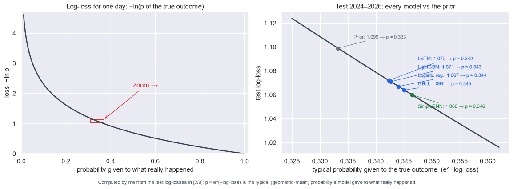
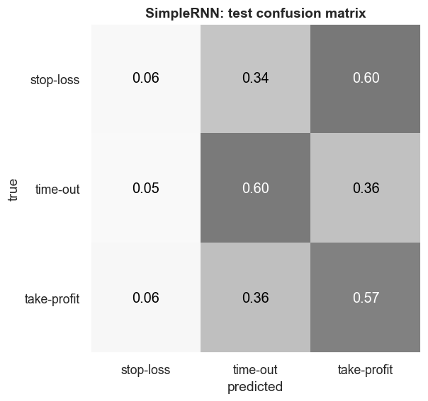
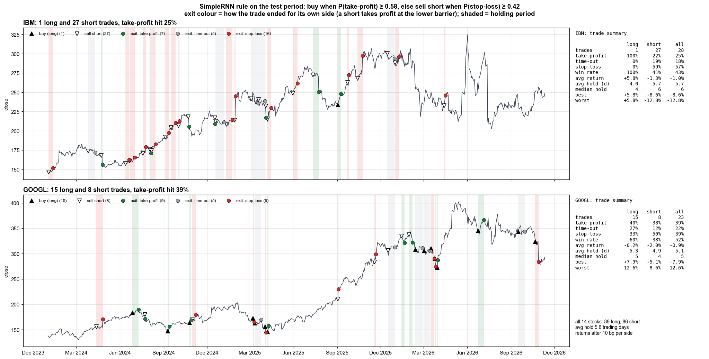
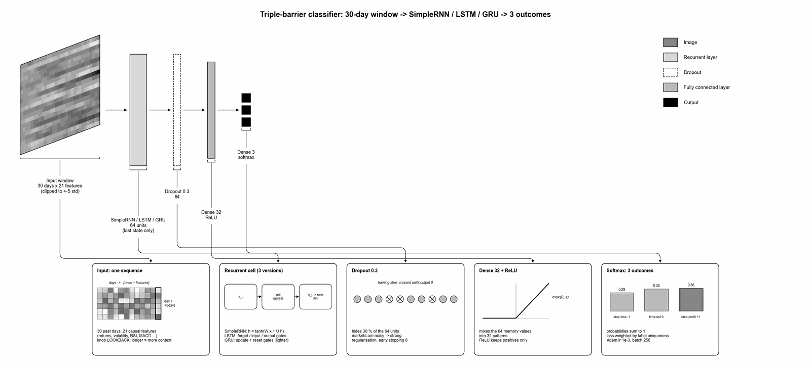
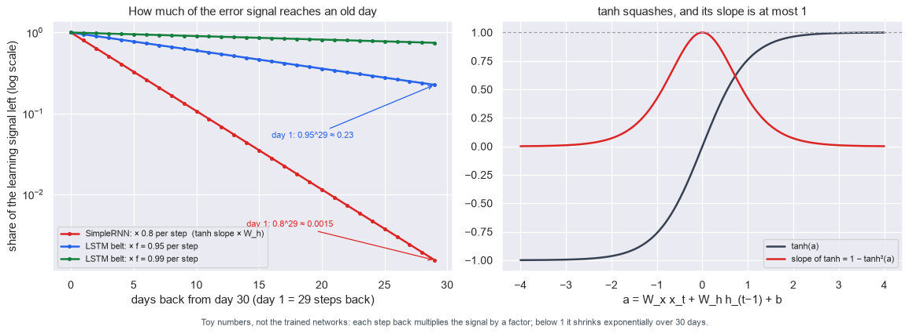

# Stock Triple-Barrier Classification (RNN / LSTM / GRU)

Many stock notebooks predict the scaled closing price with RNN, LSTM and GRU models and report R² ≈ 0.99, but copying
yesterday's price scores R² 0.995–0.9996 on price levels too. This project asks a question a trader actually faces: **if I buy today, will the trade hit its take-profit, its stop-loss, or run out of time?**

| Result on unseen data (2024-01 to 2026-10) | Value |
|---|---|
| Best log-loss (SimpleRNN) vs no-information baseline | 1.060 vs 1.099 |
| Balanced accuracy (3 classes, chance = 0.333) | 0.40-0.41 for all models |
| Long-only rule vs buy-and-hold of the same stocks (Sharpe) | 0.10-0.78 vs 1.06 |
| Best model's Sharpe vs 200 random-entry runs | beats 79 % (not significant) |

**Conclusion:** the outcome is predictable slightly better than chance, mostly *whether* a stock will move enough to hit a
barrier rather than *which way*. That edge does not turn into a trading rule that beats buy-and-hold.

## Objective


Phases 1-2 are built here; the faded Phases 3-7 (signal threshold, regime filter, risk manager, executor, monitor) are a guideline for turning the model's probabilities into a full trading loop.

- **Problem** → most "stock prediction" notebooks predict tomorrow's price and report R² ≈ 0.99, yet copying yesterday's price scores the same: it looks smart and tells a trader nothing
- **Why this repo** → ask the question a trader actually has, *"if I buy today, do I hit my take-profit, my stop-loss, or run out of time?"*, and test it without leaking the future
- **Real-world use** → a sanity check before trusting any trading signal: label trades by outcome, purge overlapping samples, and compare against buy-and-hold and random entries

## Highlights

**Question:** can a model tell whether a trade will hit take-profit, stop-loss or time out?

**Answer:** a little. The best log-loss is 1.060 against 1.099 for knowing nothing, and all five models (logistic regression, LightGBM, SimpleRNN, LSTM, GRU) are within 0.012. The models mostly learn *whether* a stock will move (volatility), not *which way*.

In probability terms, $e^{-\text{log-loss}}$ is the typical probability given to what really happened: 0.346 for SimpleRNN against 0.333 for the prior.





**Question:** does that edge make money after costs?

**Answer:** no. Model-picked trades hit take-profit 44-51 % of the time (34 % for all trades), but after 10 bp costs no rule beats buy-and-hold, and the best one beats only 79 % of random-entry runs.

| Test 2024-01 to 2026-10 | Sharpe |
|---|---|
| Buy-and-hold, same stocks | 1.06 |
| Long-only model rules | 0.10-0.78 |
| Best model vs 200 random-entry runs | beats 79 % (not significant) |


**Question:** can the model also earn when it expects a fall (long and short)?

**Answer:** no. The rule buys when P(take-profit) ≥ 0.58, and otherwise sells short when P(stop-loss) ≥ 0.42 (both thresholds fixed on validation). A short earns when the price falls, so its take-profit is the lower barrier and its stop-loss the upper one.

| SimpleRNN rule, after 10 bp costs | Validation 2022-2023 Sharpe | Test 2024-2026 Sharpe |
|---|---|---|
| Long only | 0.89 | 0.64 |
| Long + short | 1.41 | 0.42 |

Shorting looked great on validation because 2022 fell. On the rising test period, the 86 short trades hit their take-profit only 33 % of the time and lost 0.8 % each on average. Only one of five models (LSTM, 0.78 → 0.83) gains from shorts on test.

**Question:** where did the model trade, and where did each trade end?

**Answer:** the two stocks with the most short trades. IBM rose most of the period, and 16 of its 27 shorts were stopped out. GOOGL mixes 15 longs and 8 shorts. Black ▲ = buy, white ▼ = sell short, green / grey / red dot = the trade's own take-profit / time-out / stop-loss, shaded band = holding period.



All 14 stocks, test period (return of one position, which holds 1/14 of the capital, after 10 bp per side; holding time in trading days):

| Trades | Long | Short | All |
|---|---|---|---|
| Number of trades | 89 | 86 | 175 |
| Take-profit / time-out / stop-loss | 52 % / 18 % / 30 % | 33 % / 26 % / 42 % | 42 % / 22 % / 36 % |
| Win rate (return > 0) | 63 % | 47 % | 55 % |
| Average return per trade | +1.5 % | -0.6 % | +0.5 % |
| Average / median holding | 5.4 / 4 days | 5.9 / 6 days | 5.6 / 5 days |
| Best / worst trade | +18.5 % / -12.6 % | +24.6 % / -20.4 % | +24.6 % / -20.4 % |

Longs win more often than they lose; shorts lose more often than they win, and they hold a little longer because a short's take-profit (a fall) is rarer in a rising market.

**Question:** how does $1 grow, compared with simply holding the same stocks?

**Answer:** $1 → about $1.10 long only (CAGR 3.3 %, max drawdown -3 %), about $1.07 long + short (CAGR 2.2 %, max drawdown -7 %), and about $1.97 for buy-and-hold (CAGR 26.9 %, max drawdown -28 %).


## Backtesting is just another lie

**Why not trust a nice equity curve?**

A backtest replays one past I already know, with rules I chose. The curve above already hides several choices:

- **One path** → 2024-2026 happened once. A different period (2022, 2008) could flip every number.
- **Picked stocks** → 14 tech names chosen in hindsight, most of which went up (selection bias).
- **Picked model and threshold** → five models were tried; showing the best one with τ = 0.58 is already a choice, even if τ came from validation.
- **The period teaches the rule** → shorting raised the validation Sharpe from 0.89 to 1.41 because 2022 fell, then cut the test Sharpe from 0.64 to 0.42 because 2024-2026 rose.
- **Few lucky days** → about half of the long-only gain comes from April 2025, and its five best days add up to more than the whole gain.
- **Easy execution** → fills at the close, 10 bp per side, no slippage, no gaps, no missed orders.
- **Low drawdown ≠ low risk** → the -3 % drawdown looks safe because the rule sits in cash most of the time (a position is open on only 39 % of days), not because it predicts crashes.

In short → a backtest can only prove a strategy is bad, never that it is good. This one does not even beat holding the stocks.

**Question:** why do so many notebooks report great results?

**Answer:** shuffled cross-validation. Neighbouring trades share most of their future days, so a shuffled split tests on near-copies: macro-F1 0.472 shuffled vs 0.394 purged with an embargo.

## Data

Daily prices from Yahoo Finance via `yfinance`, 2010-01-01 to 2026-11-11, split and dividend adjusted:
NVDA, CRWD, AMD, ADBE, MSFT, GOOGL, INTC, AAPL, AMZN, CRM, IBM, TSLA, PYPL, XYZ (Block, formerly SQ), plus SPY as market context.
The data is not committed; notebook 01 downloads it into `data/raw/`.

## Method

**Triple-barrier labels** (López de Prado, *Advances in Financial Machine Learning*). For each stock and day $t_0$:

| Barrier | Level | Label |
|---|---|---|
| take-profit | $P_0 \cdot e^{+0.75\,\sigma\sqrt{10}}$ | +1 |
| stop-loss | $P_0 \cdot e^{-0.75\,\sigma\sqrt{10}}$ | -1 |
| time limit | 10 trading days | 0 |

$\sigma$ is the stock's recent daily volatility (past returns only), so barriers adapt to calm and turbulent periods; $\sqrt{10}$ turns a daily move into a 10-day move, $m = 0.75$ sets the class mix, and the first barrier the close touches wins, so the label follows the path. This gives 36 % take-profit,
35 % time-out and 29 % stop-loss. Labels were verified against a brute-force recomputation (300 events, 0 mismatches).

Three example trades per outcome, from a calm (2016), a turbulent (2020) and a recent (2023) year:


Every day is a possible trade; here each start day is coloured by how its 10-day trade ended:


**Overlapping labels.** Neighbouring events share most of their future days: the 53,592 events carry the information of about
8,300 independent trades. Models are trained with **uniqueness weights**, and the time split is **purged** (events whose outcome
reaches into the next period are removed).

**Features.** 21 stationary, causal features: returns, volatility, ATR, RSI, MACD, Bollinger bands, distance to moving averages,
volume, market context and a **fractionally differenced** price (stationary at $d$ = 0.30-0.45 while keeping 0.92-0.99
correlation with the price).

**Split.** Train 2010-2021, validation 2022-2023, test 2024-2026.

**Recurrent models.** Same 30-day window and head for SimpleRNN, LSTM and GRU:



A SimpleRNN ($h_t = \tanh(W_x x_t + W_h h_{t-1} + b)$) sends day 1's training signal back through tanh and $W_h$ 29 times, so it fades (vanishing gradient). LSTM and GRU update their memory by adding through gates (forget / input / output, or update / reset), so the signal can survive all 30 days. On this data that didn't help: the LSTM was the weakest learned model on validation log-loss.



## Notebooks

| Notebook | Content |
|---|---|
| [01 Data Understanding](notebooks/01_data_understanding.ipynb) | Data health, fat tails, stationarity, volatility clustering, why R² on prices misleads, scaler leakage |
| [02 Triple-Barrier Labeling](notebooks/02_triple_barrier_labeling.ipynb) | Barriers, brute-force check, sensitivity, fixed-horizon comparison, uniqueness, CUSUM filter |
| [03 Features & Purged Split](notebooks/03_features_and_split.ipynb) | Fractional differentiation, 21 features, Kruskal-Wallis effects, purged split |
| [04 Modeling](notebooks/04_modeling.ipynb) | Prior, logistic regression, LightGBM, purged vs shuffled CV, SimpleRNN / LSTM / GRU |
| [05 Evaluation & Backtest](notebooks/05_evaluation_backtest.ipynb) | Test metrics, confusion matrix, reliability, long-only and long + short backtests with costs, random-entry benchmark, SHAP |

## Findings

- **Shuffled cross-validation is badly optimistic:** macro-F1 0.472 with shuffled K-fold vs 0.394 with purged K-fold and an embargo.
- **Recurrent networks are not clearly better:** SimpleRNN, GRU, logistic regression, LightGBM and LSTM are within 0.012 log-loss on test.
- **Direction is the hard part:** true stop-losses are predicted as take-profit 60 % of the time; time-outs are recognised 60 % of the time.
- **Volatility drives the model:** `vol_21` has twice the SHAP importance of any other feature.
- **No tradable edge:** trades selected by the models hit take-profit 44-51 % of the time (34 % for all events), but after costs no
  rule beats buy-and-hold on Sharpe, and the best one sits inside the range of random entries.
- **Shorting does not rescue it:** adding short trades helped on validation (2022 fell) and hurt on test for four of five models.


## Limitations

- The 14 stocks were chosen in hindsight and mostly rose (selection bias), which makes buy-and-hold a strong benchmark.
- One test period (2024-2026, a strong market); walk-forward retraining would test other regimes.
- Simple execution: trades at the close, 10 bp per side, no slippage model, no borrow fee for shorts.

## How to run

Python 3.10. Keras 3 runs on the PyTorch backend, so it uses an NVIDIA GPU on Windows if one is available.

```bash
pip install -r requirements.txt
# run notebooks 01 to 05 in order; notebook 01 downloads the data
```

Notebook 04 takes about 10 minutes with a GPU; the others take a few minutes each.

## Run on Kaggle

[`kaggle/dl-multiclassification-stock-triple-barrier-rnn-lstm.ipynb`](kaggle/dl-multiclassification-stock-triple-barrier-rnn-lstm.ipynb) is a self-contained copy of notebooks 01 to 05 for Kaggle: one file, settings in the top cell, helper functions inline, no `src/` and no repo files needed.

1. Kaggle → Create → **Import Notebook** → upload the file (or paste its GitHub URL)
2. Settings → Accelerator **GPU T4**, Internet **On** (prices come from Yahoo Finance via `yfinance`)
3. Run All → no dataset to add; outputs land in `/kaggle/working` (`data/`, `models/`, `reports/`)
4. Keras runs on the PyTorch backend, as in the repo
