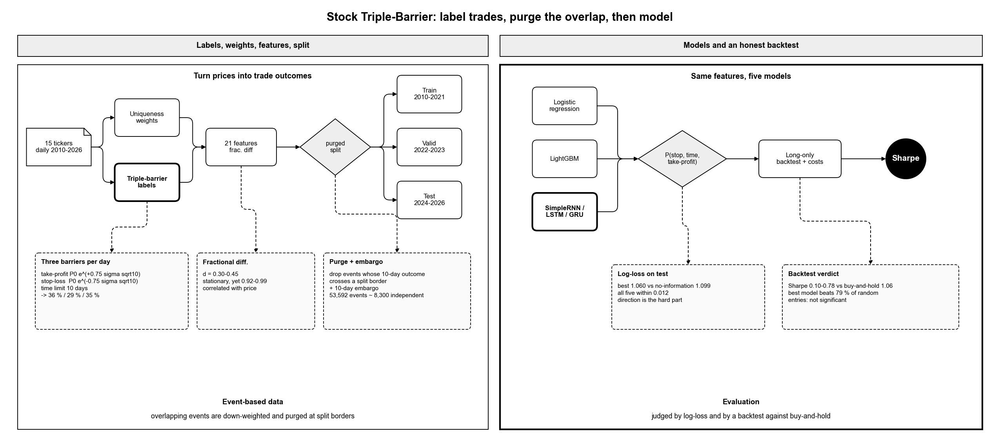

# Stock Triple-Barrier Classification (RNN / LSTM / GRU)

Second version of my stock forecasting project. The first version predicted the scaled closing price with RNN, LSTM and
GRU models and reached R² ≈ 0.99, but copying yesterday's price scores R² 0.995–0.9996 on price levels too. This version asks
a question a trader actually faces: **if I buy today, will the trade hit its take-profit, its stop-loss, or run out of time?**

| Result on unseen data (2024-01 to 2026-10) | Value |
|---|---|
| Best log-loss (SimpleRNN) vs no-information baseline | 1.060 vs 1.099 |
| Balanced accuracy (3 classes, chance = 0.333) | 0.40-0.41 for all models |
| Long-only rule vs buy-and-hold of the same stocks (Sharpe) | 0.10-0.78 vs 1.06 |
| Best model's Sharpe vs 200 random-entry runs | beats 79 % (not significant) |

**Conclusion:** the outcome is predictable slightly better than chance, mostly *whether* a stock will move enough to hit a
barrier rather than *which way*. That edge does not turn into a trading rule that beats buy-and-hold.

## Objective



- **Problem** → most "stock prediction" notebooks predict tomorrow's price and report R² ≈ 0.99, yet copying yesterday's price scores the same: it looks smart and tells a trader nothing
- **Why this repo** → ask the question a trader actually has, *"if I buy today, do I hit my take-profit, my stop-loss, or run out of time?"*, and test it without leaking the future
- **Real-world use** → a sanity check before trusting any trading signal: label trades by outcome, purge overlapping samples, and compare against buy-and-hold and random entries

## Highlights

**Question:** can a model tell whether a trade will hit take-profit, stop-loss or time out?

**Answer:** a little. The best log-loss is 1.060 against 1.099 for knowing nothing, and all five models (logistic regression, LightGBM, SimpleRNN, LSTM, GRU) are within 0.012. The models mostly learn *whether* a stock will move (volatility), not *which way*.


**Question:** does that edge make money after costs?

**Answer:** no. Model-picked trades hit take-profit 44-51 % of the time (34 % for all trades), but after 10 bp costs no rule beats buy-and-hold, and the best one beats only 79 % of random-entry runs.

| Test 2024-01 to 2026-10 | Sharpe |
|---|---|
| Buy-and-hold, same stocks | 1.06 |
| Long-only model rules | 0.10-0.78 |
| Best model vs 200 random-entry runs | beats 79 % (not significant) |


**Question:** why do so many notebooks report great results?

**Answer:** shuffled cross-validation. Neighbouring trades share most of their future days, so a shuffled split tests on near-copies: macro-F1 0.472 shuffled vs 0.394 purged with an embargo.

## Data

Daily prices from Yahoo Finance via `yfinance`, 2010-01-01 to 2026-11-11, split and dividend adjusted:
NVDA, CRWD, AMD, ADBE, MSFT, GOOGL, INTC, AAPL, AMZN, CRM, IBM, TSLA, PYPL, XYZ (Block, formerly SQ), plus SPY as market context.
The data is not committed; notebook 01 downloads it into `data/raw/`.

## Method

**Triple-barrier labels** (López de Prado, *Advances in Financial Machine Learning*). For each stock and day $t_0$:

| Barrier | Level | Label |
|---|---|---|
| take-profit | $P_0 \cdot e^{+0.75\,\sigma\sqrt{10}}$ | +1 |
| stop-loss | $P_0 \cdot e^{-0.75\,\sigma\sqrt{10}}$ | -1 |
| time limit | 10 trading days | 0 |

$\sigma$ is the stock's recent daily volatility, so barriers adapt to calm and turbulent periods. This gives 36 % take-profit,
35 % time-out and 29 % stop-loss. Labels were verified against a brute-force recomputation (300 events, 0 mismatches).

**Overlapping labels.** Neighbouring events share most of their future days: the 53,592 events carry the information of about
8,300 independent trades. Models are trained with **uniqueness weights**, and the time split is **purged** (events whose outcome
reaches into the next period are removed).

**Features.** 21 stationary, causal features: returns, volatility, ATR, RSI, MACD, Bollinger bands, distance to moving averages,
volume, market context and a **fractionally differenced** price (stationary at $d$ = 0.30-0.45 while keeping 0.92-0.99
correlation with the price).

**Split.** Train 2010-2021, validation 2022-2023, test 2024-2026.

**Recurrent models.** Same 30-day window and head for SimpleRNN, LSTM and GRU:


## Notebooks

| Notebook | Content |
|---|---|
| [01 Data Understanding](notebooks/01_data_understanding.ipynb) | Data health, fat tails, stationarity, volatility clustering, why R² on prices misleads, scaler leakage |
| [02 Triple-Barrier Labeling](notebooks/02_triple_barrier_labeling.ipynb) | Barriers, brute-force check, sensitivity, fixed-horizon comparison, uniqueness, CUSUM filter |
| [03 Features & Purged Split](notebooks/03_features_and_split.ipynb) | Fractional differentiation, 21 features, Kruskal-Wallis effects, purged split |
| [04 Modeling](notebooks/04_modeling.ipynb) | Prior, logistic regression, LightGBM, purged vs shuffled CV, SimpleRNN / LSTM / GRU |
| [05 Evaluation & Backtest](notebooks/05_evaluation_backtest.ipynb) | Test metrics, confusion matrix, reliability, backtest with costs, random-entry benchmark, SHAP |

## Findings

- **Shuffled cross-validation is badly optimistic:** macro-F1 0.472 with shuffled K-fold vs 0.394 with purged K-fold and an embargo.
- **Recurrent networks are not clearly better:** SimpleRNN, GRU, logistic regression, LightGBM and LSTM are within 0.012 log-loss on test.
- **Direction is the hard part:** true stop-losses are predicted as take-profit 60 % of the time; time-outs are recognised 60 % of the time.
- **Volatility drives the model:** `vol_21` has twice the SHAP importance of any other feature.
- **No tradable edge:** trades selected by the models hit take-profit 44-51 % of the time (34 % for all events), but after costs no
  rule beats buy-and-hold on Sharpe, and the best one sits inside the range of random entries.


## Limitations

- The 14 stocks were chosen in hindsight and mostly rose (selection bias), which makes buy-and-hold a strong benchmark.
- One test period (2024-2026, a strong market); walk-forward retraining would test other regimes.
- Simple execution: trades at the close, 10 bp per side, no slippage model, no shorting.

## How to run

Python 3.10. Keras 3 runs on the PyTorch backend, so it uses an NVIDIA GPU on Windows if one is available.

```bash
pip install -r requirements.txt
# run notebooks 01 to 05 in order; notebook 01 downloads the data
```

Notebook 04 takes about 10 minutes with a GPU; the others take a few minutes each.

## Run on Kaggle

[`kaggle/dl-multiclassification-stock-triple-barrier-rnn-lstm.ipynb`](kaggle/dl-multiclassification-stock-triple-barrier-rnn-lstm.ipynb) is a self-contained copy of notebooks 01 to 05 for Kaggle: one file, settings in the top cell, helper functions inline, no `src/` and no repo files needed.

1. Kaggle → Create → **Import Notebook** → upload the file (or paste its GitHub URL)
2. Settings → Accelerator **GPU T4**, Internet **On** (prices come from Yahoo Finance via `yfinance`)
3. Run All → no dataset to add; outputs land in `/kaggle/working` (`data/`, `models/`, `reports/`)
4. Keras runs on the PyTorch backend, as in the repo
